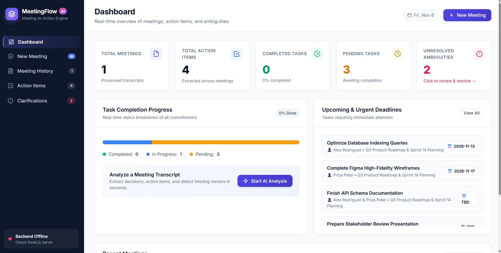

# Meeting-to-Action Assistant

A productivity web application that converts meeting transcripts into structured summaries, decisions, action items, and clarification questions. Designed to simplify meeting management and improve task accountability.

## Application Screenshot


## Features

- **Meeting Summarization:** Extracts objectives, discussion points, and key decisions.
- **Action Item Extraction:** Identifies tasks, assignees, deadlines, and priorities.
- **Ambiguity Detection:** Identifies missing information and generates clarification questions.
- **Document Upload:** Supports TXT, PDF, and DOCX files.
- **Task Management:** Create, edit, delete, search, and filter action items.
- **Meeting History:** Stores and manages previous meeting reports.
- **Clarification Center:** Resolves missing task details and updates linked records.
- **Export:** Download meeting reports as PDF and action items as CSV.
- **Demo Mode:** Includes sample meeting data for testing and evaluation.

## Technology Stack

| Component | Technology |
|---|---|
| Frontend | HTML5, CSS3, Vanilla JavaScript |
| Backend | Node.js, Express.js |
| Processing | Google Gemini API |
| File Parsing | Multer, pdf-parse, Mammoth |
| Storage | Browser LocalStorage |
| PDF Export | html2pdf.js / Print CSS |

## Project Structure

```text
meeting-assistant/
├── backend/
│   ├── server.js
│   ├── gemini.js
│   └── fileParser.js
├── public/
│   ├── index.html
│   ├── style.css
│   ├── script.js
│   └── sampleData.js
├── .env.example
├── package.json
└── README.md
```

## Installation and Setup

**Prerequisites:** Node.js 18+ and npm.

### 1. Install Dependencies

```bash
npm install
```

### 2. Configure Environment

Create a `.env` file using `.env.example`:

```env
PORT=3000
GEMINI_API_KEY=your_api_key
GEMINI_MODEL=gemini-2.5-flash
```

### 3. Start the Application

```bash
npm start
```

For development:

```bash
npm run dev
```

Open your browser at:

```text
http://localhost:3000
```

## API Endpoints

| Method | Endpoint | Description |
|---|---|---|
| GET | `/api/health` | Checks server status |
| POST | `/api/analyze` | Analyzes meeting transcripts |
| POST | `/api/upload` | Uploads and extracts documents |

## Project Objective

To automate meeting documentation, improve task accountability, identify incomplete information, and simplify follow-up management through structured meeting analysis.

## License

Open-source project developed for educational and professional demonstration purposes.
